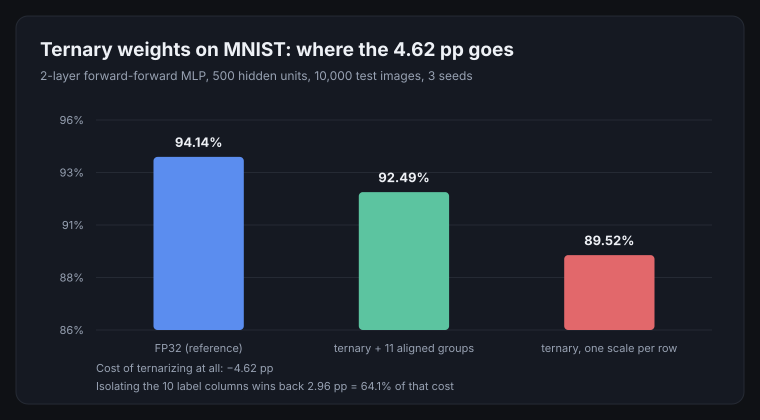
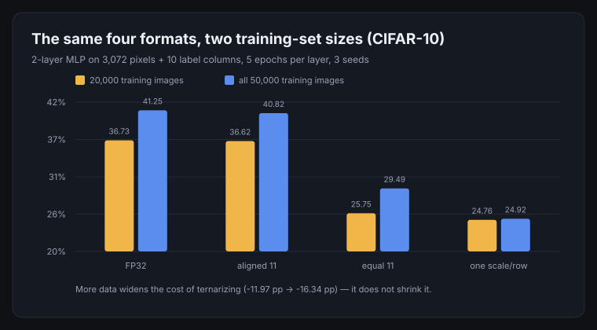
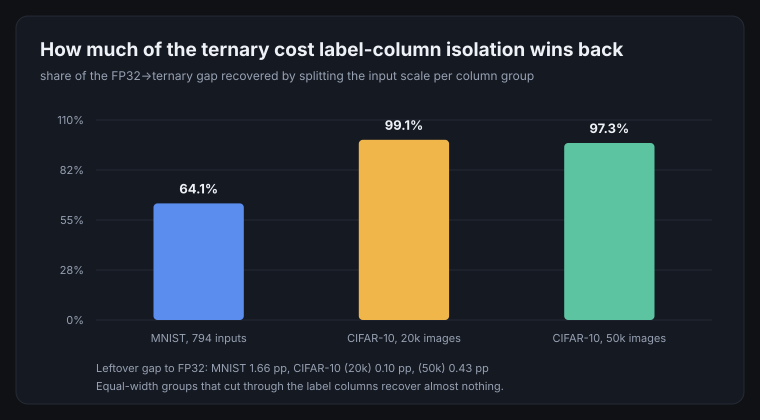
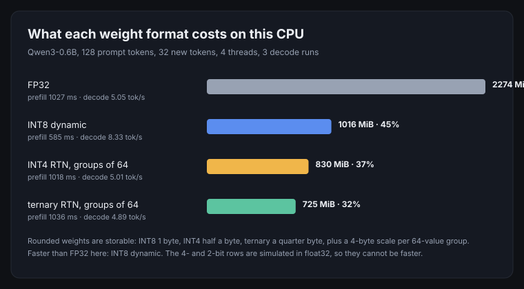
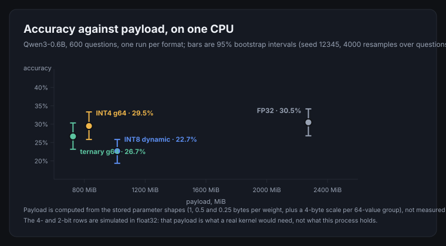

# QuantScope

[](https://github.com/David-Martinez-worldexecute/quantscope/actions/workflows/ci.yml)

**Measure what a quantization mode costs in accuracy — then prove it later.**

## In fifteen seconds

- **What it measures.** The accuracy cost of a weight format, on the same questions, with every
  single prediction stored so someone else can re-check it instead of trusting a table.
- **One result.** On a Forward-Forward network with 1.58-bit weights, ternary costs **4.62 points**;
  changing only *where the quantization scale is computed* recovers **2.96 of them (64.1%)**. The
  cost was mostly a scale-alignment problem, not a bit-width problem. Two more figures and the
  places where the argument breaks are in [what-this-is.md](docs/what-this-is.md).
- **One command.** `python -m quantscope.cli reproduce` recomputes all **101** published numbers —
  including the 171-question, four-format real-model run and its bootstrap intervals — from the
  evidence files in this repository, and fails if any of them stops following from the bytes beside
  it.
- **What it costs.** The same four formats on one CPU: payload falls from 2274 MiB to 725 MiB, but
  only the real INT8 kernel actually runs faster (585 ms prefill against 1027 ms). The 4- and 2-bit
  rows are simulated in float32, so they pay the accuracy price without collecting the speed prize —
  [the cost page](docs/cost-of-each-format.md) says which number is measured and which is analytic.
- **Try it.** `pip install quantscope`, then `quantscope demo --out runs/demo` prints a table in a
  few seconds on CPU; `quantscope run --model <dir>` runs the same pipeline on a model directory in
  the documented toy format, and `quantscope verify --run <dir>` re-checks what it recorded.

QuantScope runs the same multiple-choice questions through several weight formats of the same
model, records every prediction together with the four choice logits, and writes a manifest that
a separate `verify` command can re-check against the recorded bytes. It is a measurement tool,
not a leaderboard: it reports pairwise flips and a delta in percentage points, and refuses to
guess when the sample count does not match what was asked for.

**Start here:** [What this project is, and what I think it means](docs/what-this-is.md) — why it
exists, the five figures, four claims about AI that the measurements support, and the places where
I think the argument breaks.

## Install

```bash
pip install quantscope
```

Python 3.10+. The core needs `numpy` only and runs offline on CPU.

## Quickstart

One command builds a tiny deterministic model, evaluates three weight modes and prints a table:

```bash
quantscope demo --out runs/demo
```

Then run the same pipeline against any model directory in the documented toy format, verify the
run, and rebuild a self-contained HTML report:

```bash
quantscope run --model runs/demo/model --data data/sample_questions.jsonl \
    --n 20 --modes fp32,int4,ternary --out runs/example
quantscope verify --run runs/example
quantscope report --run runs/example
```

`verify` re-derives every prediction from the stored logits and re-checks the summary
arithmetic, the file hashes and the `complete` flag. It prints `PASS` or lists the mismatches,
and its exit code is the verdict.

## What it looks like

Every number below is read from `docs/evidence/`; the accuracy pictures come from
`ff_evidence.json`, the cost picture from `bench_qwen3_0.6b.json`, and CI fails if a checked-in
figure drifts from either file.











The scatter puts the two halves of the story in one frame: INT4 holds FP32-level
accuracy at about a third of the payload, ternary gives up eight points and — in this
implementation — buys no speed, and every interval is wide enough that 171 questions
cannot rank the middle two formats.

The cost picture is the newer half: [docs/cost-of-each-format.md](docs/cost-of-each-format.md)
has the numbers, the measurement protocol and the sentence that says which rows are simulated in
float32 and therefore cannot be faster.

## Results

The tool is the deliverable; the numbers below come from a separate controlled study that ships
in `docs/forward-forward-ternary.md`, with per-item evidence in
`docs/evidence/ff_controlled_evidence.json` (four-way ablation) and
`docs/evidence/ff_evidence.json` (mechanism follow-ups and the depth sweep).
`docs/cifar-10-two-training-sets.md` puts the two CIFAR-10 training-set sizes side by side, with
the recomputed gaps from `docs/evidence/cifar_compare.json`.

| weight format | MNIST test accuracy (mean ± std over 3 seeds) |
| --- | --- |
| FP32 | 94.14% ± 0.18 |
| all-ternary | 89.52% ± 0.48 |
| first layer FP32, second ternary | 93.57% ± 0.19 |
| first ternary, second layer FP32 | 90.43% ± 0.27 |

Same initialization per seed (verified by state hash), 12 training units, 120,000 per-item
predictions, independently re-audited. The study is about a small forward-forward network on
MNIST, not about a language model.

### Real model: Qwen3-0.6B, 171 multiple-choice questions

Measured once, on CPU, in float32, with the same prompt protocol this repository documents
(one template, A/B/C/D single-token logits, no generated reasoning):

| weight format | correct | accuracy | delta vs FP32 | flips (FP32 right→wrong / wrong→right) |
| --- | --- | --- | --- | --- |
| FP32 | 56 / 171 | 32.75% | — | — |
| INT8 dynamic (PyTorch) | 45 / 171 | 26.32% | −6.43 pp | 27 / 16 |
| INT4 RTN, group 64 | 54 / 171 | 31.58% | −1.17 pp | 28 / 26 |
| ternary (1.58-bit) | 42 / 171 | 24.56% | −8.19 pp | 49 / 35 |

Read it as one run on one 171-item set, not as a benchmark ranking: there is no seed variance
here, the interval around a 171-item accuracy is wide, and the base model answers only a third of
these questions correctly in the first place. What the numbers do support is narrower and still
useful: PyTorch's dynamic INT8 cost −6.43 pp, INT4 round-to-nearest −1.17 pp, and ternary
−8.19 pp — that ordering tells you how much of the loss is the method and how much is just
fewer bits. The flips are not symmetric either — ternary turned 49 correct answers wrong
while recovering 35.

These numbers were produced by the laboratory harness that shares this protocol, not by this
package's `run` command: v0.1.0 loads only the documented toy format. The per-item evidence,
the manifest hash and the independent re-check script live in `docs/real-model-qwen3-0.6b.md`.

### Real model: Qwen3.5-0.8B, what a load and a forward pass cost

Measured once on CPU, in bfloat16, from the public `Qwen/Qwen3.5-0.8B` snapshot — same weights,
same revision, both files re-hashed before loading:

| measurement | value |
| --- | --- |
| loading the checkpoint (2 files, 1.75 GB) | 95.64 s |
| peak working set before load / after load / after one forward | 0.38 / 3.42 / 3.49 GiB |
| prefill latency, 64 tokens (3 runs, median) | 0.61 / 0.31 / 0.38 s → 0.38 s |
| logits | `[1, 64, 248320]`, all finite |

This is an engineering probe, not a quality measurement: there is no generation loop, the input is
random token ids, and two optional kernels (`causal_conv1d`, `flash-linear-attention`) are missing,
so the reference PyTorch path — the slow one — is what ran. Details, the architecture census and the
five things this number cannot tell you are in `docs/real-model-qwen3.5-0.8b.md`; the path-free
evidence file is `docs/evidence/qwen35_forward.json`.


## Reproduce

Two commands, no GPU, no downloads:

```bash
python -m quantscope.cli reproduce   # recompute all 101 published numbers from the evidence bundle
python -m quantscope.cli demo --out runs/demo && python -m quantscope.cli verify --run runs/demo/run
```

`reproduce` re-derives every percentage in the README and in the linked study from the numbers stored
next to it (`docs/evidence/ff_evidence.json`) and fails loudly on a single mismatch; it never reads a
model, a dataset or the network. See `docs/reproduce.md` for what each check means, the pinned
environment, and the per-stage commands.
The repository ships no model weights and no third-party benchmark items; `data/sample_questions.jsonl`
contains 20 questions written for this repository.

## Limits

- Accuracy on a multiple-choice set is the only thing measured. Throughput, latency, memory and
  perplexity are out of scope.
- The `demo` model is a synthetic toy used to demonstrate the pipeline. Its numbers say nothing
  about real language models.
- v0.1.0 loads the documented toy format. Loading Hugging Face checkpoints is the next release and
  will be recorded in `docs/reproduce.md` with its own evidence, not announced here in advance.
- A run is only comparable to another run with the same protocol id, the same question file hash
  and the same sample count; the manifest records all three so a mismatch is visible.

## License

MIT. See `LICENSE`.
