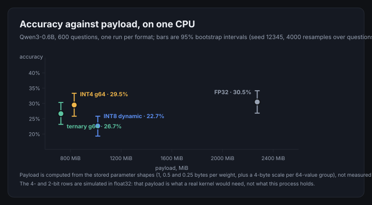

# What each weight format costs — in bytes, seconds and accuracy

A quantisation mode is a trade: fewer bytes for some accuracy. A number that says '99% of
the answers' but does not fit on the machine, or makes it four times slower, is not a trade-
off you can take. This page is the other half, measured on the same run as [the accuracy
page](real-model-qwen3-0.6b.md).

## The short version

The four rows below are the same run as the accuracy page: one Qwen3-0.6B (float32, cpu, 4
threads), 128-token prompt, 32 greedy tokens.

Payload falls from 2274 MiB to 725 MiB (68.1% smaller) for the three-value format, but on
this CPU only INT8 dynamic (PyTorch) is measurably faster at prefill.

Decode is the same story: INT8 dynamic (PyTorch) reaches 8.33 tokens per second against 5.05
for float32, and the two simulated low-bit rows land within noise of the baseline they were
quantised from.

## Payload and speed

| format | payload | vs FP32 | load + quantise | prefill (median) | decode | replaced layers |
| --- | --- | --- | --- | --- | --- | --- |
| FP32 (unquantised) | 2274 MiB | 1.00× | 5.93 s | 1027 ms | 5.05 tok/s | 0 |
| INT8 dynamic (PyTorch) | 1016 MiB | 0.45× | 15.09 s | 585 ms | 8.33 tok/s | 196 |
| INT4 RTN, groups of 64 | 830 MiB | 0.37× | 7.22 s | 1018 ms | 5.01 tok/s | 196 |
| ternary RTN, groups of 64 | 725 MiB | 0.32× | 6.05 s | 1036 ms | 4.89 tok/s | 196 |

Payload is an estimate computed from the layer shapes, not the size of a file on disk: `1`
byte per weight for INT8, `0.5` for INT4, `0.25` for ternary, each plus a 4-byte scale per
64-value group, and 4 bytes for the weights that are never quantised (`lm_head` and the
embeddings). The bundle's own `limits` say this in the machine-readable form, and
`quantscope reproduce` re-derives the numbers from those limits.

## Accuracy, from the same run

| format | correct | accuracy | 95% interval | most common answer | constant baseline |
| --- | --- | --- | --- | --- | --- |
| FP32 (unquantised) | 183 / 600 | 30.50% | 26.8–34.2% | A (75.7%) | 29.67% (always C) |
| INT8 dynamic (PyTorch) | 136 / 600 | 22.67% | 19.3–25.8% | A (79.3%) | 29.67% (always C) |
| INT4 RTN, groups of 64 | 177 / 600 | 29.50% | 25.8–33.3% | B (71.0%) | 29.67% (always C) |
| ternary RTN, groups of 64 | 160 / 600 | 26.67% | 23.2–30.3% | D (99.8%) | 29.67% (always C) |

Intervals are bootstrapped from the per-question 0/1 outcomes, seed 12345, 4000 resamples.
They overlap heavily: 600 questions cannot separate four formats that sit within a few
points of each other. That is the honest reading, and it is why the page reports intervals
next to the point estimates.

The last two columns come from the same per-question predictions. The most common answer is
the letter the format chose most often, with its share of the questions; the constant
baseline is what always answering the most frequent gold letter would earn (29.67%, always
C). A format whose share approaches 100% is not being measured by its accuracy, it is being
measured by its one answer.

The accuracy column hides one failure mode, so it is worth naming: ternary RTN, groups of 64
answered D on 599 of 600 questions, so its 26.67% is the score of one constant rather than a
reading of the question. Always answering C would earn 29.67% on the same questions, and
that collapse is invisible in a percentage on its own. [The answer-distribution table](real-
model-qwen3-0.6b.md) has the counts.

## One picture, both halves



The scatter is the shortest version of this page: moving left is cheaper to store, moving up
is more accurate. INT4 sits at FP32-level accuracy on about a third of the payload; ternary
gives up several points and, in this implementation, buys no speed; and the vertical bars --
95% bootstrap intervals over the same questions -- are wide enough that the middle two
formats cannot be ranked.

## What "simulated quantisation" actually means

Start with one weight. A linear layer holds a matrix of float32 numbers, four bytes each.
Quantising to INT4 means: cut that matrix into groups of 64 values, store one scale per
group (the largest absolute value divided by 7), and store each value as an integer in [-7,
7] — four bits, half a byte. Ternary is the same recipe with a different scale (the group
mean) and three symbols {-1, 0, +1}, two bits per value. The scale costs 4 bytes for 64
values, which is why the payload estimate is 0.5 and 0.25 bytes per weight rather than
exactly 0.5 and 0.25.

Simulated quantisation stops halfway. It rounds the values, then multiplies them straight
back by the scale and stores the result as float32 again: `w = q * s`. The numbers change,
the dtype does not. That is why the four rows above differ in accuracy but the model still
occupies float32 memory, and why the low-bit rows cannot be faster: there is nothing cheaper
to multiply. It is a way to measure the damage of rounding without changing the hardware
story.

A deployment implementation does the other half. It keeps `q` (the four-bit or two-bit
codes) as the stored weight, and dequantises inside the matrix multiply, so the float32
values exist for a tile at a time or not at all. That is what makes the memory claim real,
and what makes a speed claim possible — a fused kernel spends less bandwidth reading 4-bit
codes than 32-bit floats, and the unpack is free only because it happens in registers. The
section below is that version, built here without a fused kernel.

## What it costs when the weights are really packed

The table above is simulated quantisation. This one is the same model with the weights actually stored at 4 and 2 bits, so the payload is measured rather than estimated.

| format | payload held | vs FP32 | RSS after loading | peak RSS | prefill (median) | decode |
| --- | --- | --- | --- | --- | --- | --- |
| FP32 (unquantised) | 2274 MiB | 1.000× | 3.43 GiB | 3.47 GiB | 936 ms | 5.33 tok/s |
| INT4 packed, groups of 64 | 236 MiB | 0.104× | 3.45 GiB | 3.48 GiB | 1868 ms | 1.00 tok/s |
| ternary packed, groups of 64 | 131 MiB | 0.058× | 3.45 GiB | 3.47 GiB | 2356 ms | 0.78 tok/s |

Payload falls to 236 MiB for INT4 and 131 MiB for ternary, against 2274 MiB of float32. That
part is real: the bytes are stored, the tensors are counted, and `reproduce` re-checks the
order.

The resident set does not follow, and the table says so instead of rounding it away: loading
float32 first and packing second leaves the float32 pages counted, so RSS after loading sits
at 1.01× the FP32 figure. On this machine the allocator does not hand those pages back,
which makes a packed-then-measured process the wrong instrument for a memory claim. The next
section streams the checkpoint instead and measures the weights alone.

Speed goes the other way, and the page has to say why rather than hide it. The dequantise
here is a chunked torch path: unpack the codes, multiply by the group scale, then call the
float matmul. That is the payload win without the compute win. A deployment kernel fuses the
unpack into the matmul so the values are never materialised; the payload number would be
identical, the time number would not. So read this row as 'the storage claim is real, the
speed claim is still open'.

Peak RSS includes the interpreter, the tokenizer and one dequantised chunk, so it sits above
the payload by a fixed overhead. The bundle's `limits` list says this in machine-readable
form, and the section below repeats the short version.

## What the weights alone occupy

The packed table above still pays for the float32 checkpoint: it loads the model, then replaces its layers, so the peak carries both. This measurement removes that: it never builds the model and never runs a forward pass. It streams `model.safetensors` tensor by tensor, quantises each matrix as it arrives, keeps only the packed codes and their scales, and reports what the process holds afterwards.

| format | weights held | vs FP32 | load time | RSS after loading |
| --- | --- | --- | --- | --- |
| FP32 (unquantised) | 1680 MiB | 1.000× | 0.5 s | 2.84 GiB |
| INT4 packed, groups of 64 | 236 MiB | 0.141× | 1.5 s | 0.74 GiB |
| ternary packed, groups of 64 | 131 MiB | 0.078× | 1.5 s | 0.60 GiB |

Here the memory column finally tracks the payload: 1.64 GiB of float32 becomes 0.23 GiB at 4
bits and 0.13 GiB at 2 bits. The caveat is that this is a storage measurement, not a runtime
one: no activations, no KV cache, no dequantisation buffer. It says what a deployment would
have to keep on disk or in memory to hold these weights, which is the number the low-bit
formats are actually sold on.

## A real 4-bit container, on the GPU

The rows above are simulations: float32 weights rounded to fewer levels and written back. They estimate what a low-bit format would cost, not what one does cost. bitsandbytes NF4 is a real container — block-wise normal-float codes with scales that are themselves quantised — so it is worth measuring on its own terms, on the same checkpoint, on the GPU.

| format | weight bytes held | vs FP32 | prefill (median) | decode | answers agreeing with FP32 (of 12) |
| --- | --- | --- | --- | --- | --- |
| FP32 | 2274 MiB | 1.00× | 92 ms | 17.04 tok/s | — |
| NF4 (bitsandbytes 0.50.2) | 507 MiB | 0.22× | 159 ms | 16.33 tok/s | 7 |

It costs 4.5 times fewer bytes and it keeps answering. On the 12 questions both formats answered, NF4 agrees with FP32 on 7 and spreads its answers over several letters; the mean absolute drift in the four choice logits is 1.92. The ternary row above holds a comparable number of bytes and answered the same letter 599 times out of 600. Two formats of similar size therefore did very different things to this model, which is the reason the collapse is reported as a property of that quantiser rather than of 'low bits' in general.

Three limits apply. The comparison is 12 questions, so it can show that answers did not collapse, not that accuracy is preserved. NF4 is not the group-64 round-to-nearest quantiser used above, so the two cannot be read as the same operation at different widths. And the memory column is `torch.cuda.memory_allocated`, which counts weight tensors, not the resident set of the process.

The numbers are recomputed by `python -m quantscope.cli reproduce` from `docs/evidence/nf4_bench.json`, including the check that the per-dtype byte map adds up to the total it reports.

## What this is not

INT8 here is `torch.ao.quantization.quantize_dynamic`, not GGUF `Q4_K_M` and not
bitsandbytes NF4. Prefill and decode were measured on one CPU, torch 2.6.0+cu124, float32, a
128-token prompt and 32 greedy tokens; a GPU, a longer context or a fused kernel would move
the time columns and leave the payload column where it is.

The memory column is not per-format memory either: each row is a fresh child process, so the
four peaks are comparable with each other, but each still contains the interpreter, the
tokenizer and the float32 weights that simulated quantisation refuses to give up.

## Reproduce it

```bash
python -m quantscope.cli reproduce                # re-derives every number on this page
python scripts/make_figures.py --check            # the figure is byte-identical to the bundle
```

The page itself is generated from the bundles by a lab-side script, so a number here that disagrees with `docs/evidence/` cannot survive a rebuild.
