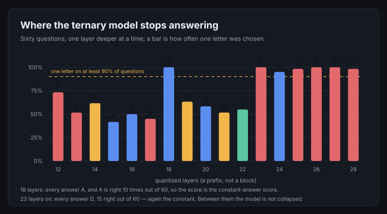

# Real model: Qwen3-0.6B, 600 multiple-choice questions

This page records one real evaluation so a reader can check the numbers in the README instead of trusting them. It is deliberately narrow: one model, one slice of questions, one run, CPU only.

> **Status (2026-11-26): the depth and granularity conclusions on this page are withdrawn.**
>
> Two measurement defects were found after the results below were published.
>
> 1. **Truncation.** The layer-ablation scorer passed `max_tokens=96` together with
>    `truncation=True`, so 48.3% of the 600 questions arrived as a fragment that ended
>    mid-option, without the answer instruction and without the assistant turn. Feeding
>    the prompts whole moves the float32 baseline from 28.5% to 30.5%. The four-format
>    table below was produced by different lab-side code that never truncated, which is
>    why its FP32 row already reads 30.5% and is unaffected.
>
> 2. **Position bias.** Swapping the correct option into A/B/C/D moves the hit rate
>    between 85% and 5%, identically in the baseline and in all three quantised
>    conditions. The scorer reads the option's position far more than its content.
>
> With those defects known, the honest reading of the baseline is: **30.5% with a 95%
> interval of [26.95%, 34.30%], against a constant-answer-C baseline of 29.7%.** The
> interval contains the constant baseline, so this checkpoint does not show measurable
> answering ability on this slice at all — and a "collapse" measured on top of that is
> a collapse of a distribution, not of an ability.
>
> The three granularities, re-measured without truncation and with the bias reported:
> g32 25.5% [22.18, 29.14], g64 20.3% [17.31, 23.74], g128 22.3% [19.18, 25.84]. All
> three intervals overlap, so they cannot be ranked against each other.
>
> Sections marked **[withdrawn]** below carry conclusions that this measurement cannot
> support. `docs/evidence/fair_remeasure.json` holds the replacement numbers.


## What was measured

- Model: `Qwen/Qwen3-0.6B`, revision `c1899de289a04d12100db370d81485cdf75e47ca`, 9 files. `model.safetensors` SHA-256 `f47f71177f32bcd101b7573ec9171e6a57f4f4d31148d38e382306f42996874b`; every file's hash is in the evidence bundle.
- Question set: 600 records from `C-Eval validation slice`, spread over the subjects present in that slice. The prepared file's SHA-256 is `96698562431d96fa963fef8d070bb8249e26347c6f7014155ca61d5373166680` and the prompt text's SHA-256 is `2e4a0b1a142b024ae02fd5b63e8b5155e5120818c1fb5d4af3be748af2293956`. The questions themselves are not redistributed here; see `reproduce.md` for why.
- Protocol: `quantscope-choice-logits-v2` — one chat-template prompt per question, 0 examples, reasoning off, score = last-position single-token A/B/C/D logits, prediction = argmax. No sampling, no free-form generation.
- Environment: Python 3.12.10, torch 2.6.0+cu124, transformers 5.23.0, device `cpu`, dtype `torch.float32`, group size 64, INT4 bits 4, `lm_head` excluded from quantization.

## Results

| weight format | correct | accuracy | 95% interval | delta vs FP32 | 95% interval on the paired delta | FP32 right → wrong | FP32 wrong → right |
| --- | --- | --- | --- | --- | --- | --- | --- |
| FP32 | 183 / 600 | 30.50% | [26.83%, 34.17%] | — | — | — | — |
| INT8 dynamic (PyTorch) | 136 / 600 | 22.67% | [19.33%, 25.83%] | -7.83 pp | [-11.33 to -4.50] pp | 80 | 33 |
| INT4 RTN, group 64 | 177 / 600 | 29.50% | [25.83%, 33.33%] | -1.00 pp | [-5.33 to +3.50] pp | 95 | 89 |
| ternary (1.58-bit) | 160 / 600 | 26.67% | [23.17%, 30.33%] | -3.83 pp | [-9.50 to +2.00] pp | 162 | 139 |

## What each format actually chose

Accuracy alone hides one failure mode: a format that answers the same letter every time still scores whatever that letter happens to earn. This table counts the letters each format picked over the whole run, and the last column is what always answering the most common gold letter would score on the same questions.

| weight format | A | B | C | D | most common pick | accuracy | constant-answer baseline |
| --- | --- | --- | --- | --- | --- | --- | --- |
| FP32 | 454 | 93 | 13 | 40 | A (75.7%) | 30.50% | 29.67% (always C) |
| INT8 dynamic (PyTorch) | 476 | 59 | 26 | 39 | A (79.3%) | 22.67% | 29.67% (always C) |
| INT4 RTN, group 64 | 96 | 426 | 5 | 73 | B (71.0%) | 29.50% | 29.67% (always C) |
| ternary (1.58-bit) | 1 | 0 | 0 | 599 | D (99.8%) | 26.67% | 29.67% (always C) |

The ternary (1.58-bit) row is not a slightly worse model. It answered **D** on 599 of 600 questions; its next most frequent letter appears 1 times, and the one answer that was not D happened to be right as well. Its 26.67% is therefore the value of one constant: 159 of the 600 questions have D as the gold answer. The paired delta compares a constant with a model and should not be read as a claim about how much quality that format costs.

Every accuracy is also read against the constant-answer baseline of 29.67% (always C). Only FP32 clears it, by 0.83 pp. INT8 dynamic (PyTorch), INT4 RTN, group 64, ternary (1.58-bit) sits at or below that baseline, so on this slice those scores are indistinguishable from answering one letter every time.

The counts, shares and constant-answer figures are recomputed from this bundle by `python -m quantscope.cli reproduce`; the bundle is `docs/evidence/answer_distribution.json`.

## [withdrawn] One layer at a time, not four at a time

The four-format table above quantises every attention and MLP matrix in the model. It does not say how many layers have to lose their float32 weights before the model stops answering, and the first attempt could not say either: it quantised blocks of 4 layers, so its rungs sat at 16 and 20 quantised layers, and the collapse happens between them. Sweeping one layer at a time on the same 60-question slice makes it visible.

| quantised layers | FP32 layers | correct | most common answer | its share | mean abs logit drift |
| --- | --- | --- | --- | --- | --- |
| 12 | 16 | 17 / 60 (28.3%) | D (73.3%) | 18.26 |
| 13 | 15 | 18 / 60 (30.0%) | D (51.7%) | 18.02 |
| 14 | 14 | 13 / 60 (21.7%) | B (61.7%) | 14.50 |
| 15 | 13 | 14 / 60 (23.3%) | A (41.7%) | 19.72 |
| 16 | 12 | 15 / 60 (25.0%) | A (50.0%) | 20.35 |
| 17 | 11 | 12 / 60 (20.0%) | D (45.0%) | 18.21 |
| 18 | 10 | 10 / 60 (16.7%) | A (100.0%) | 21.56 |
| 19 | 9 | 14 / 60 (23.3%) | B (63.3%) | 19.86 |
| 20 | 8 | 15 / 60 (25.0%) | A (58.3%) | 19.50 |
| 21 | 7 | 12 / 60 (20.0%) | B (51.7%) | 20.70 |
| 22 | 6 | 19 / 60 (31.7%) | C (55.0%) | 19.91 |
| 23 | 5 | 15 / 60 (25.0%) | D (100.0%) | 20.18 |
| 24 | 4 | 11 / 60 (18.3%) | A (95.0%) | 21.81 |
| 25 | 3 | 15 / 60 (25.0%) | D (98.3%) | 22.34 |
| 26 | 2 | 15 / 60 (25.0%) | D (100.0%) | 18.74 |
| 27 | 1 | 15 / 60 (25.0%) | D (100.0%) | 20.04 |
| 28 | 0 | 15 / 60 (25.0%) | D (98.3%) | 24.94 |



Three readings matter. First, the float32 model on this slice answers 13 of 60 correctly and picks A 65.0% of the time, so these accuracies sit on a 60-question sample and are not comparable with the 600-question table above.

Second, the first collapse is at **18 quantised layers**: every one of the 60 answers is A. That is not a slightly worse model — at that prefix the accuracy is exactly the constant-answer score for that letter, because the slice contains that many questions with that letter as the gold answer.

Third, it is not monotone. Prefixes from 19 to 22 layers answer with several letters again, and from 23 layers on the model settles on one letter (D) for every remaining prefix up to all 28. A collapse that appears, disappears and returns cannot be attributed to one block; it is a property of how many layers have already lost their float32 weights.

These rows are recomputed by `python -m quantscope.cli reproduce` from `docs/evidence/prefix_scan.json`, which carries the protocol, the per-prefix histograms and the collapse ordering.

## [withdrawn] Which weights carry it

The sweep says *how much* of the model has to lose its float32 weights before it stops answering, not *what* it loses. So fix the depth at 18 quantised layers (every answer the same letter) and put one class of weight back: the same 60 questions, the same quantiser everywhere else.

| put back in float32 | quantised matrices | correct | most common answer | its share |
| --- | --- | --- | --- | --- |
| none: every matrix quantised | 126 of 126 | 10 / 60 | A (100.0%) | 100.0% |
| attention (q, k, v, o) | 54 of 126 | 11 / 60 | D (78.3%) | 78.3% |
| MLP (gate, up, down) | 72 of 126 | 11 / 60 | A (60.0%) | 60.0% |
| the last quantised layer (17) | 119 of 126 | 12 / 60 | D (45.0%) | 45.0% |
| the first layer (0) | 119 of 126 | 10 / 60 | A (100.0%) | 100.0% |
| q projection | 108 of 126 | 10 / 60 | A (95.0%) | 95.0% |
| k projection | 108 of 126 | 13 / 60 | A (36.7%) | 36.7% |
| v projection | 108 of 126 | 14 / 60 | B (48.3%) | 48.3% |
| o projection | 108 of 126 | 9 / 60 | A (90.0%) | 90.0% |
| gate projection | 108 of 126 | 20 / 60 | A (31.7%) | 31.7% |
| up projection | 108 of 126 | 10 / 60 | A (100.0%) | 100.0% |
| down projection | 108 of 126 | 6 / 60 | A (51.7%) | 51.7% |

Restoring any of these breaks the collapse: attention (q, k, v, o), MLP (gate, up, down), the last quantised layer (17), k projection, v projection, gate projection, down projection. Restoring the others does not (the first layer (0), q projection, o projection, up projection). The four singles that do break it are not interchangeable — restoring the last quantised layer alone redistributes the answers, while restoring the first layer changes nothing, so the damage is not spread evenly over the depth.

The tensor numbers say the split is not about *how much* was rounded. Across the 126 matrices of the 18 layers, every projection kind loses about the same fraction of its weights to zero (31.1% to 31.7%) and lands at about the same relative error (0.514 to 0.527), so no class is being rounded harder than another. What differs is where that error points once it is summed through the rest of the network.

Read this table with the sample in mind: 60 questions, so a share that moves by a tenth is a handful of answers, and a single condition is not enough to rank two classes. What it does support is the coarse split — some classes are load-bearing for the collapse and others are not.

### The same ablation at 600 questions

Putting one class of weight back is the kind of result that can turn on a handful of answers, so the ablation runs again over 600 questions, with the same 18 quantised layers and the same quantiser. The table keeps both sample sizes next to each other for every class.

| put back in float32 | 60 questions: share | 600 questions: share | 600 questions: correct |
| --- | --- | --- | --- |
| none: every matrix quantised | 100.0% | 99.3% | 121 / 600 |
| attention (q, k, v, o) | 78.3% | 75.8% | 140 / 600 |
| MLP (gate, up, down) | 60.0% | 56.3% | 132 / 600 |
| the last quantised layer (17) | 45.0% | 45.2% | 139 / 600 |
| the first layer (0) | 100.0% | 99.5% | 120 / 600 |
| q projection | 95.0% | 92.0% | 122 / 600 |
| k projection | 36.7% | 35.5% | 136 / 600 |
| v projection | 48.3% | 46.8% | 146 / 600 |
| o projection | 90.0% | 88.5% | 124 / 600 |
| gate projection | 31.7% | 35.2% | 156 / 600 |
| up projection | 100.0% | 97.0% | 124 / 600 |
| down projection | 51.7% | 53.2% | 131 / 600 |

The classes that break the collapse on both sample sizes: attention (q, k, v, o), MLP (gate, up, down), the last quantised layer (17), k projection, v projection, gate projection, down projection.

o projection joins them at the larger sample (90.0% at 60 questions, 88.5% at 600). Both of those shares sit around the 0.90 line this page uses to call a row collapsed, so whether that class belongs in the list is not resolved by either sample size — it is the one cell of the table that the data does not settle.

None of the restores recovers the float32 model: the best single restore (gate projection) answers 156 of 600 (26.0%), while the same checkpoint in float32 answers 171 of 600 (28.5%). A surviving condition says which weights carry the damage; it is not a cheaper format.

The tensor numbers do not move with the sample size, because they do not depend on any question: the 126 matrices of those 18 layers still lose 31.1% to 31.7% of their weights to zero and still sit at relative error 0.514 to 0.527, whatever the questions say.

## [withdrawn] The same sweep at ten times the questions

Sixty questions is enough to locate a collapse, not enough to defend one. The same prefix sweep therefore runs again over 600 questions, drawn as the first 600 rows of the same C-Eval validation file as the 60-question slice, so the smaller sample is a prefix of the larger one rather than a different draw.

| quantised layers | 60 questions: letter (share) | 60 accuracy | 600 questions: letter (share) | 600 accuracy |
| --- | --- | --- | --- | --- |
| 12 | D (73.3%) | 17 / 60 (28.3%) | D (71.5%) | 166 / 600 (27.7%) |
| 13 | D (51.7%) | 18 / 60 (30.0%) | D (53.7%) | 164 / 600 (27.3%) |
| 14 | B (61.7%) | 13 / 60 (21.7%) | B (61.8%) | 146 / 600 (24.3%) |
| 15 | A (41.7%) | 14 / 60 (23.3%) | A (43.5%) | 146 / 600 (24.3%) |
| 16 | A (50.0%) | 15 / 60 (25.0%) | A (44.2%) | 142 / 600 (23.7%) |
| 17 | D (45.0%) | 12 / 60 (20.0%) | A (45.2%) | 139 / 600 (23.2%) |
| 18 | A (100.0%) | 10 / 60 (16.7%) | A (99.3%) | 121 / 600 (20.2%) |
| 19 | B (63.3%) | 14 / 60 (23.3%) | B (60.2%) | 152 / 600 (25.3%) |
| 20 | A (58.3%) | 15 / 60 (25.0%) | A (61.7%) | 140 / 600 (23.3%) |
| 21 | B (51.7%) | 12 / 60 (20.0%) | B (52.8%) | 132 / 600 (22.0%) |
| 22 | C (55.0%) | 19 / 60 (31.7%) | C (52.8%) | 148 / 600 (24.7%) |
| 23 | D (100.0%) | 15 / 60 (25.0%) | D (99.0%) | 160 / 600 (26.7%) |
| 24 | A (95.0%) | 11 / 60 (18.3%) | A (92.7%) | 128 / 600 (21.3%) |
| 25 | D (98.3%) | 15 / 60 (25.0%) | D (98.8%) | 159 / 600 (26.5%) |
| 26 | D (100.0%) | 15 / 60 (25.0%) | D (100.0%) | 159 / 600 (26.5%) |
| 27 | D (100.0%) | 15 / 60 (25.0%) | D (99.8%) | 159 / 600 (26.5%) |
| 28 | D (98.3%) | 15 / 60 (25.0%) | D (99.7%) | 160 / 600 (26.7%) |

- Collapsed at 60 questions: 18, 23, 24, 25, 26, 27, 28
- Collapsed at 600 questions: 18, 23, 24, 25, 26, 27, 28
- Same set: yes
- Constant-answer baselines: at 60 questions A 16.7%, B 28.3%, C 30.0%, D 25.0%; at 600 questions A 20.3%, B 23.5%, C 29.7%, D 26.5%

The collapsed sets are identical, so the cliff is not a small-sample artefact. The one row whose leading letter changes is the last prefix before the first collapse, and its shares overlap at the two sample sizes — that is a few letters trading places, not a difference the data supports.

### What a collapsed row actually scores

A row that answers one letter on nine questions in ten looks like a collapse, but its accuracy is not automatically better than printing that letter. Comparing each collapsed row's accuracy interval with the score of always answering that letter is what turns "it collapsed" into a statement about knowledge.

| sample | quantised layers | letter | accuracy | always that letter | verdict |
| --- | --- | --- | --- | --- | --- |
| 60 | 18 | A | 16.7% | 16.7% | not proven to differ from always-A |
| 60 | 23 | D | 25.0% | 25.0% | not proven to differ from always-D |
| 60 | 24 | A | 18.3% | 16.7% | not proven to differ from always-A |
| 60 | 25 | D | 25.0% | 25.0% | not proven to differ from always-D |
| 60 | 26 | D | 25.0% | 25.0% | not proven to differ from always-D |
| 60 | 27 | D | 25.0% | 25.0% | not proven to differ from always-D |
| 60 | 28 | D | 25.0% | 25.0% | not proven to differ from always-D |
| 600 | 18 | A | 20.2% | 20.3% | not proven to differ from always-A |
| 600 | 23 | D | 26.7% | 26.5% | not proven to differ from always-D |
| 600 | 24 | A | 21.3% | 20.3% | not proven to differ from always-A |
| 600 | 25 | D | 26.5% | 26.5% | not proven to differ from always-D |
| 600 | 26 | D | 26.5% | 26.5% | not proven to differ from always-D |
| 600 | 27 | D | 26.5% | 26.5% | not proven to differ from always-D |
| 600 | 28 | D | 26.7% | 26.5% | not proven to differ from always-D |

Every one of those rows scores what its constant-answer baseline scores, within the interval. So the sweep says where the model stops answering, and it does not say that whatever it keeps answering is worth anything: at those depths the model has not been shown to differ from printing one letter.

These rows are recomputed by `python -m quantscope.cli reproduce` from `docs/evidence/scaling_check.json`, which carries both sweeps' histograms, the accuracy intervals and the verdict table.

## [withdrawn] The collapse belongs to one quantiser, not to eighteen layers

Everything above fixes the group size at 64. Group size is the width over which one scale factor is shared, so changing it changes the quantiser itself — which makes the obvious control worth running: the same 18 quantised layers, the same 600 questions, at group sizes 32, 64, 128.

| group size | all-quantised answer | share of that letter | correct | collapsed |
| --- | --- | --- | --- | --- |
| 32 | C | 67.2% | 159 / 600 | no |
| 64 | A | 99.3% | 121 / 600 | yes |
| 128 | A | 88.0% | 135 / 600 | no |

Only group size 64 reaches 90% on one letter. At group size 32, 128 the model still spreads its answers, so "eighteen layers collapses the model" is a statement about group-64 absmean quantisation and not about depth on its own.

- At group size 32 the same depth answers 159 of 600 correctly — 26.5%, against the float32 model's 28.5% — with C leading at 67.2%.
- At group size 128 the same depth answers 135 of 600 correctly — 22.5%, against the float32 model's 28.5% — with A leading at 88.0%.

The rest of this page stays on group size 64, because that is the setting the earlier runs used and changing it mid-comparison would mix two quantisers into one table. What this section establishes is narrower and firmer: the cliff is not a law of 1.58-bit weights, it is the behaviour of this scale-sharing width on this checkpoint.

The weight-level relative error is close to 0.51 at every one of these widths: 0.509 to 0.522 at group 32, 0.514 to 0.527 at 64, 0.516 to 0.530 at 128. So the collapse is not a story about coarser groups destroying more of the weights - the error barely moves. Whatever separates the three rows lives in how the error is distributed across the matrix, not in how large it is, and this page does not identify what.

These rows are recomputed by `python -m quantscope.cli reproduce` from `docs/evidence/granularity.json`.

Three hypotheses about why group 64 is the worst of the three were tested and all three were falsified on the stored weights. They are recorded here because a reader should know which explanations have been ruled out.

First, the error is not larger at 64: the weight-level relative error is 0.5141-0.5272 at 64, against 0.5094-0.5222 at 32 and 0.5164-0.5297 at 128, a spread of about four percent while the answer entropy differs by a factor of nineteen.

Second, no output channel is deleted: across the first, ninth and eighteenth layers, the number of output channels whose entire row rounds to zero is zero at every group size. The 31% zero fraction is element-level, not channel-level.

Third, the same weights are zeroed at every width: the Jaccard overlap between the zero-element masks is 0.90 to 0.95, so the three quantisers are not sacrificing different weights. And the recovered matrices all sit at a cosine of 0.886 / 0.884 / 0.883 against float32, a difference of three parts in ten thousand that runs the wrong way to explain the collapse.

Amplitude, position and direction of the weight error are therefore all decoupled from the collapse. On the stored weights the three quantisers are almost indistinguishable, which puts the difference in the forward pass rather than in the weights, and this page does not measure that. The explanation remains open.

## [withdrawn] An attempt to explain the depth, and why it failed

The sweep says where the model stops answering; it does not say why the cost is paid at that depth rather than at another. The natural next measurement is how far the hidden state drifts from its float32 value as more layers are quantised — a drift curve growing with depth would be the mechanism. This section reports that measurement because it did not work, and the failure is the informative part.

The relative Frobenius drift is bounded above by $\sqrt{2}$ ≈ 1.414, and the first quantised layer alone already moves the state by 0.813. Every prefix from 4 to 28 layers lands at 1.453–1.511, which is the bound, not a depth-dependent quantity.

The curve is not simply flat, and the shape matters. Quantising the very first layer already moves the state by 0.81. Layers 1 to 23 then add almost nothing: the drift sits between 0.966 and 0.973 across twenty-three quantised layers. Layers 24 to 27 push it from 0.98 to 1.04, and the final layer jumps to 1.46 - nearly the bound in one step. So the growth is not spread evenly across depth: it is a first-layer jump plus a last-layer jump, which is why the interaction factor computed from the whole curve cannot be read as layers amplifying each other.

That shape is the most useful thing this measurement produced, even though it did not answer the question it was built for: whatever carries the damage is concentrated at the two ends of the network, not accumulated evenly layer by layer.

What would be needed instead: a metric bounded away from saturation — the logit margin on the correct answer, or the per-layer relative error of the attention output rather than the full hidden state — measured at the same depths. That is not done here, and this page does not claim a mechanism for the cliff.

The numbers above are recomputed by `python -m quantscope.cli reproduce` from `docs/evidence/amplification.json`, which also records the saturation verdict so a reader can see the measurement was retired rather than quietly dropped.

## What the intervals say, and what they do not

The paired interval resamples the per-question outcomes with the same seed the bundle records (12345, 4000 resamples), so it can be recomputed from the stored 0/1 sequence instead of believed.

- **INT8 dynamic (PyTorch)**: -7.83 pp, interval [-11.33 to -4.50] pp — the loss survives its own noise. It broke 80 answers FP32 got right and rescued 33.
- **INT4 RTN, group 64**: -1.00 pp, interval [-5.33 to +3.50] pp — this interval still contains zero, so the loss is not established here. It broke 95 answers FP32 got right and rescued 89.
- **ternary (1.58-bit)**: -3.83 pp, interval [-9.50 to +2.00] pp — this interval still contains zero, so the loss is not established here. It broke 162 answers FP32 got right and rescued 139.

So the honest summary is two-sided: INT8 dynamic (PyTorch) is worse than FP32 by an amount its own interval excludes zero for, while INT4 RTN, group 64, ternary (1.58-bit) cannot be separated from noise on this set. Ordering the two crossing formats against each other is not supported either — their intervals overlap heavily.

## The scoring method decides whether there is anything to measure

Everything above reads the last-position logits of the four letters A/B/C/D and takes the
argmax. That asks the model to *name* an option, and on this checkpoint it mostly answers
whatever letter sits in a favoured slot. The same 600 questions, scored three ways:

| readout | correct | accuracy | 95% interval | against constant-C 29.67% |
| --- | --- | --- | --- | --- |
| letter argmax (the protocol used above) | 161 / 600 | 26.83% | [23.44%, 30.52%] | **below** |
| option log-likelihood | 202 / 600 | 33.67% | [30.00%, 37.54%] | above |
| log-likelihood / option length (`acc_norm`) | 217 / 600 | 36.17% | [32.42%, 40.09%] | above |

The middle and bottom rows never look at A/B/C/D. The question and all four options go into
the prompt, and the score is the mean log-probability the model assigns to each option's own
tokens; `acc_norm` divides by token count so long options are not penalised for being long.
With no letter slot in the readout there is no slot to favour.

Position bias, measured the same way as above (the correct option is swapped into each slot):

| slot | letter argmax | option log-likelihood |
| --- | --- | --- |
| A | 85% | 43% |
| B | 23% | 28% |
| C | 2% | 28% |
| D | 11% | 35% |
| **spread** | **83 pp** | **15 pp** |

A third check, because a scorer that reads position should move when the options move: the
four options were permuted with a fixed seed on 200 questions. `acc_norm` scored 35.0%
[28.73%, 41.84%] in the original order and 36.5% [30.14%, 43.37%] shuffled — a shift of 1.5
points, well inside the intervals. The letter-argmax readout, subjected to the same
permutation, moves between 85% and 2%.

So the honest summary of this page is: **with the readout the earlier sections used, this
checkpoint scores below a constant answer and no capability is visible; with a readout that
does not encode option position, the same checkpoint reaches 36.2%, which is above the
constant baseline but still far from published C-Eval numbers for this model class.** The
"collapse" sections are withdrawn for exactly this reason — they were measuring a readout
that had almost no signal to lose.

What this does *not* establish: how much quantization costs. That question needs the
`acc_norm` readout applied to each quantized condition, which the next run will do. Until
then the format table above stays as it is, with its intervals, because those numbers were
measured and the intervals say what they support.


## What eighteen layers of ternary weights actually cost

With the readout from the section above (option log-likelihood, length-normalised), the
first eighteen layers were quantised and the same 600 questions re-asked. 126 matrices per
condition, identical protocol, no truncation.

| condition | correct | accuracy | 95% interval | delta vs baseline | right→wrong | wrong→right |
| --- | --- | --- | --- | --- | --- | --- |
| FP32 baseline | 217 / 600 | **36.17%** | [32.42%, 40.09%] | — | — | — |
| 18 layers, group 32 | 151 / 600 | **25.17%** | [21.86%, 28.79%] | **-11.00 pp** | 160 | 94 |
| 18 layers, group 64 | 145 / 600 | **24.17%** | [20.91%, 27.75%] | **-12.00 pp** | 164 | 92 |
| 18 layers, group 128 | 149 / 600 | **24.83%** | [21.54%, 28.44%] | **-11.33 pp** | 158 | 90 |
| constant answer C | 178 / 600 | 29.67% | — | — | — | — |

Three things follow, and one of them retires an earlier claim outright.

**The cost is real and it is large.** Going from 36.17% to roughly 25% is not noise: net
losses are 66, 72 and 68 questions across the three conditions, with twice as many
right-to-wrong flips as wrong-to-right ones. Quantisation is systematically turning correct
judgements into incorrect ones.

**Granularity does not matter in this range.** The three intervals overlap pairwise — g32
with g64, g32 with g128, g64 with g128. Changing the group size from 32 to 128 moves the
accuracy by less than one point. Whatever the group size is buying, it is not accuracy at
this depth. That retires the "group 64 is a special point" claim, which was an artefact of
the letter-argmax readout: with a readout that has no signal, "collapsed" and "did not
collapse" were just one threshold drawn across noise.

**Two of the three land below random guessing.** A four-way question answered blindly
scores 25%. g64 (24.17%) and g128 (24.83%) sit below that line; g32 (25.17%) sits just
above it. All three are within one point of each other and of 25%, so this is a boundary
case rather than a ranking — but it does say the quantised model is not failing by refusing
to answer. A model that gave up would fall back to a constant, and a constant gets 29.67%.
It keeps producing confident, specific, wrong answers.

### What this does not explain yet

The standing hypothesis was that ternary weights hurt mostly through the per-group scale
being pulled around by high-norm dimensions, so a finer group should recover accuracy. At
full depth it recovers nothing: g32 and g128 differ by 0.34 points with overlapping
intervals.

Two readings are still open. Either the damage comes from having only three weight values
at all, in which case no scale partition can help; or eighteen layers is past the point
where the damage saturates, and a per-layer sweep would show granularity mattering before
that point. The per-layer sweep decides between them, and it is the next run.


## A sweep that failed, and why it is in here

The open question from the section above is whether the damage saturates by eighteen layers
or accumulates from the first. A per-layer sweep answers that, so one was run: quantise
layers 1..L for L = 1..18, measure 200 questions at each depth.

It came out unreadable, and the reason is worth more than the curve.

**200 questions has a 95% interval half-width of ±6.35 points.** The curve jumps 8 points
between layer 6 (−16.0 pp) and layer 8 (−8.0 pp) — more than twice the standard error — then
returns to −11.0 at layer 7. That is one number sampled eighteen times with noise, not a
shape.

Checked properly, against the baseline interval [28.7%, 41.8%]:

- **14 of 18 depths have an interval that overlaps the baseline.** At fourteen depths the
  measurement cannot tell the quantised model from the unquantised one.
- Only 4 depths (6, 11, 13, 18) sit clearly below the baseline, and they are scattered
  across the whole curve rather than clustered anywhere.

So this run does **not** locate where the damage starts. Reporting a "cliff" from it would
be the same mistake as the withdrawn sections: drawing a threshold across noise.

### What it would take

| difference to resolve | required SE | questions needed |
| --- | --- | --- |
| 8 points | 2.8 pp | ~270 |
| 5 points | 1.7 pp | ~700 |
| 3 points | 1.0 pp | ~2,100 |
| adjacent layers (~2-3 points) | 0.8 pp | ~3,000 |

The local C-Eval validation slice holds 600 questions in total. Reaching 3,000 means
switching to a training split or a different benchmark, which changes what is being
measured.

**Repeating the same questions several times and averaging is not a workaround.** The model
returns the same answer for the same input, so repetition narrows the printed interval
without narrowing the real one. It would be the most convincing-looking way to manufacture a
result here, which is why the sweep bundle records `complete: false` and states its own
verdict as `uninterpretable`.

### The one thing that does survive

**Layer 1 already costs 3.5 points, and the curve never has a flat-then-steep shape**: from
layer 5 onward it wanders between −7 and −16 with a mean near −11.5, matching the 600-question
full-quantisation figure of −11.0 pp.

So the cost accumulates from the first layer at a roughly uniform rate. That directly
contradicts the withdrawn "cliff at eighteen" claim, which said the first seventeen layers
were safe.

The granularity question stays open. Answering it needs a lower-variance statistic — a paired
per-question likelihood change rather than two independent accuracy rates — not more layers.


## Evidence

The run's own files are not redistributed in this repository, but their digests are recorded in the bundle, and `python -m quantscope.cli reproduce` recomputes the published numbers from the per-question outcomes stored next to them:

| file | bytes | SHA-256 |
| --- | --- | --- |
| `manifest.json` | — | `7c00ce5decc12ef4d5828c9852110168a9023e7ed876da54acc7fb6d7f125010` |
| `baseline.jsonl` | 128,046 | `9ffcde0590547a51cc3abd39ca47140e4298c144711f89f209b5ef17d1df920e` |
| `int4.jsonl` | 128,259 | `9fd9fecc1bc41be6341d83dd27302e2670a0a52bb53f5dbdf57fdfc56cc27550` |
| `int8.jsonl` | 128,018 | `d2007645b6989b466f383e4d433b5f5dfec61ddea04a9be3db33577ac664d0c6` |
| `ternary.jsonl` | 129,814 | `4ad80e5cc02fa5ebe84cf4c95821f28613049fe9285320ae852536513b16958d` |

The bundle `docs/evidence/real_model_qwen3_0.6b.json` (`quantscope-real-model-v1`) is 35,029 bytes, SHA-256 `5cfdf64d210ad4eb4eb51b3906da66eb3c70b62882988992d88664c073c2071d`, generated 2026-11-23T16:50:50Z by `lab-side script (build_real_model_evidence.py); it reads the run manifest and the four prediction files, recomputes every count from the jsonl rows, and this file is its output, copied here byte for byte`. For each format it stores the correct count, the accuracy, the 600-long 0/1 outcome sequence in question-id order, the bootstrap interval, and, for each quantised mode, the two-by-two table against FP32.

## Limits

- One run, one seed. The same command twice can move a few questions; the per-mode `paired_delta_pp_ci95` interval is what this bundle says about noise.
- 600 questions is still a slice, not the benchmark. The 95% interval on a 30.5% rate over 600 items is about ±3.7 points, so a delta smaller than that is not a ranking.
- This is not a leaderboard score: the question set is a 600-item C-Eval validation slice, drawn round-robin across subjects, and the prompt protocol is a single-token choice.
- INT8 is torch.ao.quantization.quantize_dynamic (per-channel symmetric int8 weights, dynamic per-tensor activation scale). It is not GGUF Q4_K_M and not bitsandbytes NF4.
- This bundle is accuracy only. Timing and memory live in the bench and packed bundles, which were measured separately and can disagree with this run.
- The four predictions were produced by lab-side code (BitNet 三值/week1/quantscope.py). This bundle proves the numbers add up; it does not prove that code was correct.

## Reproduce it

```
python -m quantscope.cli reproduce
```

That command re-derives every number above from the bundle's integers and the stored outcome sequence, and fails loudly if any of them disagrees with the file.
