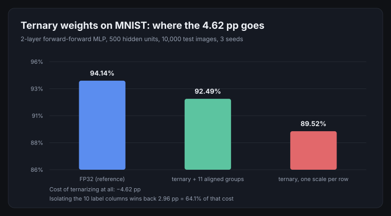
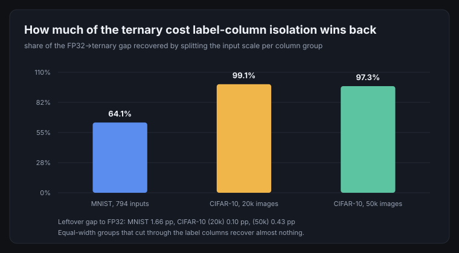
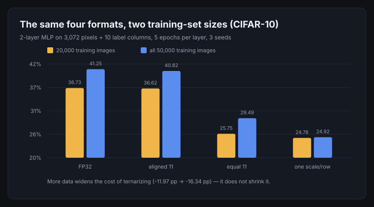
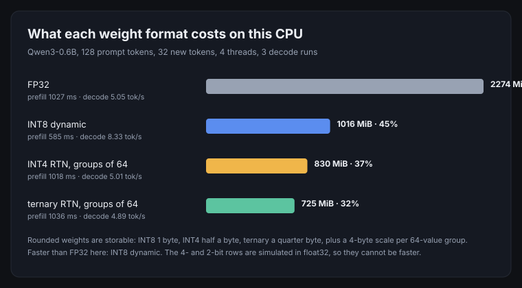

# What this project is, and what I think it means

This page is the argument behind the repository, in my own voice. The tables in
[`forward-forward-ternary.md`](forward-forward-ternary.md) are the measurements;
this is why I made them, what I think they mean, and where I think the reasoning
would break.

## Why I built it

Quantization posts usually end with a percentage. "1.58-bit weights, 89.5% on
MNIST." The number is real, but it arrives stripped of everything needed to
disagree with it: which images, which seed, which layer, what the baseline was,
whether the quantized layers actually ran.

I built QuantScope because I wanted to answer a smaller and harder question:
*what does a weight format cost, on this machine, with this data, and can someone
else check me without trusting me?* That second clause is the whole design. A run
writes down every prediction and every logit. A separate program re-derives the
accuracy from those files. A third program recomputes every published number from
the evidence bundle. Each layer can fail independently, and when it does, it says
so.

So the repository is not "here is a result". It is "here is a result, here is the
record it came from, and here is the command that will call me a liar if the two
drift apart."

## The shape of it

```text
run.py  ──►  manifest + predictions (sha256 of data, model, protocol)
                     │
                     ├─► verify   : re-derive accuracy, argmax, hashes
                     ├─► reproduce: recompute all 389 published numbers
                     └─► figures  : five SVGs, rendered from the evidence
```

Three properties I cared about, in order:

1. **Offline.** The checks need `numpy`, nothing else. No model weights, no
   network. A stranger clones the repo and runs `python -m quantscope.cli reproduce`
   in seconds.
2. **Boring on purpose.** No dashboards, no tracking, no "leaderboard". A JSON
   file, a few assertions, a non-zero exit code.
3. **Guarded by CI, not by my memory.** GitHub Actions runs the unit tests, the
   reproduction, the figure byte-comparison, and — in a separate job, so a torch
   install cannot take the evidence checks down with it — a one-minute
   Forward-Forward experiment with a direction assertion.

## What I measured

### The cost of ternarizing is not uniform



Two-layer MLP, full MNIST, three seeds. FP32 reaches 94.14%; the same network
with ternary weights reaches 89.52%. That 4.62 pp is the honest headline.

But look at what the drop is made of. Only the *scale grouping* was changed:
instead of one scale per output row over the whole 794-column input, the 784 pixel
columns share one scale and each of the ten one-hot label columns gets its own.
Accuracy goes to **92.49%**, recovering **2.96 pp — 64.1% of the entire cost** —
with no extra bits, no extra parameters, no retraining schedule. A second,
independent aligned run measured 92.43% (+2.91 pp), so this is not one lucky seed.

### Bit width is the weaker lever

Also from the evidence bundle: making the first layer 2-bit instead of ternary
recovers **0.62 pp**; making both layers 2-bit recovers **1.03 pp**. Compare that
with the 2.96 pp from moving a scale boundary. On this network, *where the scale
is computed* buys roughly five times what *how many levels* buys.



That is the finding I would defend. It is also the one I would expect to fail on
a model whose input is homogeneous — which is exactly why the next step was a
dataset where pixels and labels are not the only two kinds of input.

### The ordering survives more data, and widens



On CIFAR-10, the same two-layer architecture, 20,000 training images: FP32
36.73%, per-row ternary 24.76%, aligned 36.62% (recovering 99.1% of an 11.97 pp
cost), mis-aligned 25.75%. With all 50,000 images the cost grows to **16.34 pp**
and the aligned run still recovers **97.3%** of it, while the mis-aligned run
recovers only 4.57 pp. The separation between aligned and mis-aligned grouping
goes from 10.88 pp to 11.33 pp.

More data did not shrink the problem. It made the *difference between two ways of
placing the same scale* more visible. That is the opposite of what "more data
fixes everything" would predict, and it is why I bothered to run the second
training set at all.

### A small real-model check

Qwen3-0.6B, 600 multiple-choice questions, one run per format, CPU:

| weight format | correct | accuracy | 95% interval | delta vs FP32 | 95% interval on the paired delta |
| --- | --- | --- | --- | --- | --- |
| FP32 | 183 / 600 | 30.50% | 26.83–34.17% | — | — |
| INT8 dynamic (PyTorch) | 136 / 600 | 22.67% | 19.33–25.83% | −7.83 pp | −11.33 to −4.50 pp |
| INT4 RTN, group 64 | 177 / 600 | 29.50% | 25.83–33.33% | −1.00 pp | −5.33 to +3.50 pp |
| ternary, group 64 | 160 / 600 | 26.67% | 23.17–30.33% | −3.83 pp | −9.50 to +2.00 pp |

Two things are true at once, and I want both on the record:

- **Only the INT8 loss is established here.** Its paired interval is −11.33 to −4.50 pp,
  which excludes zero: it broke 80 answers FP32 got right and rescued 33.
- **The other two are not.** INT4 (−1.00 pp) and ternary (−3.83 pp) both have paired
  intervals that contain zero, and their intervals overlap each other heavily. Saying
  "ternary is worse than INT4" is not supported by this set.
- **Ternary is not slightly worse; it stopped answering.** It picked D on 599 of 600
  questions, so its 26.67% is the constant-answer score for D (159 questions have D as
  gold). Always answering C would earn 29.67%, which INT8 (22.67%) also fails to clear.
  A percentage hides that; the letter counts do not.
- **The collapse is cumulative, and it belongs to that quantiser.** Sweeping prefixes one
  layer at a time puts the first collapse at 18 quantised layers (all 60 answers A) and a
  stable one from 23; the earlier four-layer grid stepped 16 -> 20 and never landed on
  either rung. A real 4-bit container (NF4, on the GPU) holds 4.5x fewer bytes, keeps
  answering, and spreads its answers over several letters on the same 12 questions — so
  'low bits' is not the cause on its own.
- **The damage is load-bearing, not spread evenly.** At 18 quantised layers, putting k, v,
  gate or down back to float32 brings the answers back (best: 20/60); putting q, o, up
  or the whole first layer back leaves every answer on one letter. All seven kinds lose
  31.1%-31.7% of their weights to zero, so nothing was rounded harder -- the
  difference is where that error goes next.

This same table used to have 171 rows, and at that size every one of the three intervals
contained zero — I reported "no accuracy loss is demonstrated" and meant it. Tripling the
question count established one loss and left two open. That reversal is the most useful
thing on this page: the conclusion moved because the sample moved, not because the model
did.

### What each format costs, on one CPU



Accuracy was only half of the question. The other half is what a format buys:
the same 128-token prompt and 32-token greedy decode, four formats, one machine
(16 cores, float32, `torch` 2.6.0). Payload drops from **2274 MiB** to
**1016 MiB** with INT8, **830 MiB** with INT4, and **725 MiB** with ternary.
Only the INT8 row also gets faster — 585 ms prefill instead of 1027 ms — because
it is the only row that runs a real quantised kernel. The 4- and 2-bit rows are
simulated in float32, so they save memory on paper and pay a small penalty in
time. That distinction is the whole point of the page:
[the measurement and its limits](cost-of-each-format.md).

The payload numbers are arithmetic from the layer shapes; two further runs turn them
into measurements. Packing the 196 matrices and then keeping only the packed codes
drops the stored weights from **1680 MiB** to **236 MiB** (INT4) and **131 MiB**
(ternary), and in that run the resident set follows: 2.84 GiB down to 0.74 and 0.60
GiB. Packing *after* a full float32 load does not follow — RSS stays flat and decode
falls to 1.0 and 0.8 tok/s, because that path unpacks a chunk at a time with no fused
kernel. Both receipts are in `docs/evidence/`.

## What I actually think about AI

Four claims, each tied to something above.

**1. Quantization is mostly an interface problem, not a precision problem.**
The label columns are ten columns out of 794 — about 1.3% of the input width — and
they wreck a quantiser that assumes the row is homogeneous. Fixing *where the scale
is computed* recovers 2.96 of the 4.62 pp gap on MNIST (64.1%), with three seeds
per cell and the per-item predictions audited. The fix was not a better rounding
rule; it was telling the quantiser what the input *is*. My generalization: most
"the model broke" stories in AI are interface stories — assumptions about the shape
of an input leaking into a component that was never told about the shape. Precision
gets blamed because it is easy to change.

**2. Locality is a property of the wiring, not of a layer.** Forward-Forward is
sold as "local learning", and I wanted to see how local. Moving label injection
from layer 0 to layer 1 drops accuracy to 79.92% (−9.60 pp, worse than plain
ternary at 89.52%), and layer-0 features alone classify at 60.90% by nearest
centroid. Those are point estimates from a 10,000-image test set, not intervals —
but a 9.6-point move is far outside the 0.48 pp seed spread, so the direction is
not in doubt. Layer 0 is simultaneously the bottleneck *and* the only place
supervision enters. Calling that "local" is formally true and practically
misleading: the layer is local in its gradients and global in its job.

**3. A percentage hides the thing you want to know.** "−1.00 pp" could be 5 answers
flipped out of 400, or 95 broken and 89 rescued — same number, different worlds. The
real-model table is the worked example, and it got sharper when the set grew from 171
to 600 questions. At 171, INT8 sat 6.43 pp below FP32 with a paired interval of
[−14.04, +1.17] pp — inside its own noise, so I wrote "no loss demonstrated". At 600
the same method's interval is [−11.33, −4.50] pp: the loss now survives, while INT4
(−1.00 pp, [−5.33, +3.50]) and ternary (−3.83 pp, [−9.50, +2.00]) still cross zero.
Nothing about the quantisers changed; the sample did. A conclusion that flips with n
is a conclusion that was never about the model. Paired counts (`right→wrong`,
`wrong→right`), a sample size and an interval are the minimum honest unit of reporting.

**4. Claims about machine intelligence need accounting, not adjectives.** What
struck me most is not that a 1.58-bit network reaches 89.5% — it is how much of
the "1.58-bit" story is really a story about *where the scale goes*. The cost page
is the same ledger in another currency: 2274 MiB → 725 MiB is arithmetic on the
layer shapes, 1027 ms → 585 ms is a measured wall clock on one CPU, and the page
says which number is which. When a dramatic-sounding property dissolves into a
bookkeeping choice, that is usually the sign of an honest measurement, not a
disappointing one. I would rather publish a boring mechanism with a ledger than an
exciting number with a paragraph.

## What this does not say

- Two-layer MLPs, no convolutions, one dataset family. A transformer result would
  need its own run, not an extrapolation from this one.
- Three seeds. The 4.62 pp cost is stable across them; the third decimal place is
  not.
- The real-model table is a single run per format, on 600 questions from one C-Eval
  validation slice. It is a sanity check, not a benchmark entry, and the intervals say
  which parts of it are established and which are not.
- INT8 here is `torch.ao.quantization.quantize_dynamic`. It is neither GGUF
  `Q4_K_M` nor bitsandbytes NF4. Speed and payload are measured, but only here:
  one CPU, `torch` 2.6.0, 128-token prompt, 32 greedy tokens. The payload column is
  computed from the layer shapes rather than read off disk, and peak RSS in a fresh
  process still includes the float32 weights that simulated quantisation keeps.
- `reproduce` proves internal consistency: the published numbers agree with the
  evidence bundle and with the arithmetic in the source. It does not re-run the
  experiment. Re-running is what `experiments/ff_mnist` and the documented commands
  are for.

## Check me in three minutes

```bash
pip install quantscope
python -m quantscope.cli reproduce        # 389 numbers, from the evidence bytes
python -m quantscope.cli demo --out runs/demo
python -m quantscope.cli verify --run runs/demo/run
```

For the Forward-Forward result itself:

```bash
cd experiments/ff_mnist
python run.py --group aligned --train 4000 --test 1000 --epochs 5 --download --out runs/aligned.json
python run.py --group row     --train 4000 --test 1000 --epochs 5 --out runs/row.json
python assert_direction.py --aligned runs/aligned.json --row runs/row.json
```

That is the same pair of commands CI runs. Locally it takes about ten seconds
after the 11 MB MNIST download; the numbers will not equal the table above,
because 4,000 images is a smoke test and the table is not. What it does check is
that the mechanism still points the same way.

## Where I would go next

- A convolutional or transformer model with a heterogeneous input, to test claim 1
  outside this architecture.
- Per-group scale *learning* instead of a hand-placed boundary: if the grouping is
  what matters, a learned grouping should beat my eleven hand-cut spans.
- A proper multi-seed real-model run, so the INT8/INT4 comparison either survives
  or dies with a stated interval.

If you find a number here that does not reproduce, that is the most useful thing
you can tell me: `reproduce` exits non-zero, and the manifest has the checksums to
argue with.
